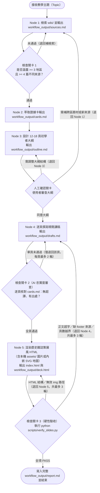

# 工作流：從 LLM Wiki 生成教學型 HTML 簡報（`topic-slides`）

本工作流嚴格遵循 [AGENTS.md](../../AGENTS.md) 與 [wiki/index.md](../../wiki/index.md) 之規範架構，將 `wiki/`（涵蓋俄國、德國、西班牙、中國、南斯拉夫五大區域及 `01_russian_civil_war.md`～`06_yugoslav_partisans.md` 六份唯讀原始來源）轉化為面向「**無歷史背景初學者**」的單檔離線互動式教學簡報。

## 全域鐵律與目錄約定

1. **唯讀與零外部知識**：嚴禁修改、覆寫或刪除 `raw/` 任何檔案；本工作流僅依據 `wiki/`（必要核對原文措辭時唯讀查閱 `raw/`）生產內容，嚴禁混入外部知識或模型自身記憶。
2. **嚴格溯源與語言規範**：正文採繁體中文，專有名詞首次出現時以括號附註原文（英文、德文、俄文、日文等）；所有年份、數據、人物與論點須保留 `[來源檔名, 段落標題]`；資料缺漏處須如實標註 `[資料不足／不確定：具體缺漏說明]`；史觀衝突處須並列呈現「觀點 A `[出處]`」與「觀點 B `[出處]`」。
3. **產物存放位置**：
   - 所有**中間產物與驗證報告**統一存放於 `workflow_output/`：
     - `workflow_output/sources.md`（Node 1：檢索清單與覆蓋率統計）
     - `workflow_output/cards.md`（Node 2：結構化證據卡）
     - `workflow_output/outline.md`（Node 3：初學者 12～18 頁教學大綱）
     - `workflow_output/drafts.md`（Node 4：逐頁精簡講稿與來源附註）
     - `workflow_output/deck.html`（Node 5：工作流備份簡報檔，與根目錄 `index.html` 同步一致）
     - `workflow_output/report.md`（Node 4～5：忠實度審查與每輪腳本驗收修正歷程報告）
   - **本機圖片素材庫**：若簡報採用歷史影像 ``，須先下載並驗證儲存於專案根目錄 `assets/`。
   - **最終展示入口**：同步輸出至專案根目錄 `index.html`（方便 GitHub Pages 直接展示，與 `assets/` 搭配離線運作）。

---

## Graph 狀態流轉與局部退迴路線圖



---

## Node 1：主題檢索與覆蓋率關卡

- **輸入**：使用者給定的教學主題、[wiki/index.md](../../wiki/index.md)。
- **執行動作**：
  1. 先精讀 `wiki/index.md` 五大分類索引（`sources/`、`ideologies/`、`factions/`、`events/`、`syntheses/`），鎖定與教學主題直接及跨區連動之頁面。
  2. 善用 `wiki/syntheses/` 兩篇跨區比較頁與頁面內 `[[雙向連結]]`，識別隱含跨區關聯（例如白俄流亡部隊跨越俄、中、西三地；國際縱隊南斯拉夫志願者連結西班牙與南斯拉夫；列寧主義民主集中制與蘇聯軍援連結俄、中、西、南）。
  3. 統計入選頁面實際涵蓋的**地理區域**（俄國、德國、西班牙、中國、南斯拉夫）與實際溯源之**原始來源檔案**（`01_russian_civil_war.md`～`06_yugoslav_partisans.md`）。
  4. 寫入 `workflow_output/sources.md`。
- **`workflow_output/sources.md` 必備結構**：
  - 主題界定與教學焦點
  - 覆蓋率檢核表（區域清單及計數；原始來源清單及計數）
  - 入選 Wiki 頁面清單（欄位：`Wiki 相對路徑`、`涵蓋區域`、`關聯原始來源`、`一句話入選理由`）
  - 初步識別之 `raw/` 資料缺口提醒
- **檢查關卡 1（覆蓋率門檻）**：
  - 必須同時滿足：**(1) 至少涵蓋 3 個不同地理區域**；**(2) 至少引用 4 篇以上不同 `raw/` 原始來源檔案**。
  - **退回路線**：若任一條件不符，**立即退回 Node 1** 擴大檢索範圍（追蹤雙向連結或跨區事件頁）並更新 `workflow_output/sources.md`。若確因 `raw/` 收錄範圍限制而無法滿足，依誠實不知原則向使用者回報缺口並請求調整教學主題，絕不引入外部資料硬湊。

---

## Node 2：萃取證據卡

- **輸入**：通過檢查關卡 1 之 `workflow_output/sources.md` 及對應 `wiki/` 頁面內文。
- **執行動作**：
  1. 精讀入選的 `wiki/` 頁面正文，拆解為獨立可追溯的**原子化證據卡**（建議每張卡片聚焦單一核心事實、因果比較、數據組或史觀爭議）。
  2. 每張卡片必須嚴格雙重綁定：
     - 所屬 Wiki 頁面路徑：`[wiki/分類/檔名.md]`
     - 原始出處標籤：`[來源檔名, 段落標題]`（逐字核對 Wiki 頁面原有溯源標籤，不擅自簡化或臆測段落）
  3. 若該議題在 `wiki/` 存有史觀矛盾（如「防衛必要 vs. 一黨獨裁」、「SDP 抵禦布爾什維主義 vs. 背叛工人／妥協過頭」、「紅白恐怖規模與組織化爭議」、「皖南事變先開火互控」、「南斯拉夫戰後清洗與修正主義」等），**必須在同一張或成對卡片並列「觀點 A `[出處]`」與「觀點 B `[出處]`」**。
  4. 若遇 `[資料不足／不確定：...]` 標記，原樣摘錄至卡片缺漏備忘，供大綱與講稿誠實揭示邊界。
  5. 寫入 `workflow_output/cards.md`。
- **卡片標準格式範例**：
  ```markdown
  ### CARD-01：[卡片主題名稱]
  - **地區／流派／事件**：...
  - **Wiki 出處**：`[wiki/分類/檔名.md]`
  - **原始出處**：`[0X_來源檔名.md, 段落標題]`
  - **核心證據（含原文專有名詞、年份與數據）**：...
  - **史觀對照／缺漏備註**：...（無則填「單一記載，無史觀衝突」或詳列對照／`[資料不足／不確定：...]`）
  ```
- **輸出**：`workflow_output/cards.md`（嚴禁出現任何未標示出處或來自 `raw/` 以外的知識）。

---

## Node 3：教學大綱與人工確認關卡

- **輸入**：`workflow_output/cards.md`。
- **受眾原則（面向「沒有歷史背景的初學者」）**：
  - 不假設讀者事前認識任何縮寫或事件背景：大綱須先設定時代問題與地理座標，再由淺入深推進（例如：共同起點 -> 關鍵概念與陣營譜系 -> 地區對比案例 -> 跨區連動網絡 -> 史觀交鋒與研究留白 -> 總結提問）。
  - **禁止單頁過載**：每頁只設定 **1 個清楚的教學結論（Takeaway）** 與最多 2～4 個聚焦要點，為後續 Node 4 的「正文區（排除 `<footer>` 頁底出處）<= 280 字」與雜誌版面留白／圖像搭配預留充裕空間。
- **執行動作**：
  1. 設計 **12～18 頁**（建議核心為 **12～16 頁**）循序漸進的教學簡報大綱，確保落在 Node 5 硬性驗收之 **12～18 頁**區間內，並適度拆頁以配合圖文或地理圖表呼吸感。
  2. 每頁大綱須寫明：
     - `第 X 頁：標題`
     - `給初學者的白話問題／學習目標`
     - `排版視覺型態`（如：專屬深色全版面封面、文圖雙欄雜誌版面、內嵌 SVG 地理態勢／流向圖、水平編年時間軸、報紙雙欄史觀對照、數據／引文焦點頁、總結提問頁；**嚴禁**在所有內頁重複使用左側粗色條圓角卡片）
     - `視覺素材規劃`（註明該頁預計搭配本機 `assets/` 歷史圖片、內嵌 `<svg>` 地圖／示意圖，或採純印刷排版）
     - `綁定卡片清單`（明確列出 `CARD-XX`）
     - `該頁預計引用之原始來源`（便於檢查全篇覆蓋率）
  3. 輸出至 `workflow_output/outline.md`。
- **人工確認關卡（Human-in-the-Loop Pause）**：
  - 完成 `workflow_output/outline.md` 後，**必須暫停工作流，不得擅自進入 Node 4**。
  - 向使用者展示 12～18 頁大綱摘要（含覆蓋地區數、來源數與教學順序邏輯），請使用者明確回覆確認。
  - **退回路線**：
    - 若使用者對頁面順序、教學深淺或標題編排不滿意：**退回 Node 3** 修改 `workflow_output/outline.md` 並再次送交確認。
    - 若使用者認為缺少關鍵地區、流派或史料面向：**退回 Node 1** 補充檢索，依序重跑 Node 2 更新 `cards.md` 與 Node 3 更新 `outline.md` 後再請確認。

---

## Node 4：逐頁講稿與忠實度局部審查

- **輸入**：使用者已確認之 `workflow_output/outline.md` 與 `workflow_output/cards.md`。
- **撰稿規範**：
  1. 依 `outline.md` 逐頁撰寫講稿，輸出至 `workflow_output/drafts.md`（每頁清楚以 `## Slide XX：標題` 分隔）。
  2. **初學者友善且精簡條列**：
     - 使用簡潔短句與雜誌級精煉條列（建議每頁 2～4 點，每點約 20～45 字；**正文區（不含頁底來源行）**嚴控於 **120～240 純文字字元**，確保渲染為 HTML 後排除 `<footer class="slide-source">` 仍遠低於 **280 字**硬性上限，絕不擠佔版面留白與圖片空間）。
     - 專有名詞首次出現時附註原文括號（從 `cards.md` 沿用，不可自行替換或補譯）。
     - 若需呈現史料未載處，直接保留 `[資料不足／不確定：...]`；史觀衝突頁必須雙邊並列。
  3. **頁底強制標註來源出處**：每一頁講稿末尾必須附帶獨立一行來源標記，格式須包含 `來源：` 與至少一組 `[0X_來源檔名.md, 段落標題]`（例如：`來源：[01_russian_civil_war.md, 導言]; [04_warlord_era_china.md, Aftermath]`），並在草稿註記所對應之 `CARD-XX` 編號以便追溯。因自動化腳本排除 `<footer class="slide-source">` 計算正文字數，頁底來源應保持完整準確，無須刪減章節路徑。
- **檢查關卡 2（AI 忠實度審查與單頁局部 Loop）**：
  - 審查員視角逐頁比對 `workflow_output/drafts.md` 與 `workflow_output/cards.md`，核檢以下 4 項：
    1. 所有年份、百分比、金額、人數與人名／組織均精確吻合 `cards.md`，無張冠李戴。
    2. 無任何未經卡片記載的延伸推論、價值評斷或外部史實補腦（零超譯）。
    3. 頁底含完整 `來源：...` 與 `[來源檔名, 段落標題]`，且該頁正文區（不含頁底來源行）實質字數預估 <= 240 字（為 HTML 280 字硬性上限保留安全緩衝）。
    4. 遇史觀衝突時維持中立並列；遇缺漏時誠實標記不硬湊。
  - **局部退回機制（關鍵規則）**：
    - 凡發現任何頁面違規，**僅退回並重新撰寫出錯的那一頁（或那幾頁）**，已通過審查的其餘頁面保持鎖定不動，嚴禁推翻整份重寫。
    - **每頁局部 Loop 上限為 2 輪**。若單頁連改 2 輪仍因證據卡本身資訊不足而難以達標，必須改採 `[資料不足／不確定：...]` 誠實揭示並調整教學粒度。
    - 將各頁第 1／2 輪忠實度審查紀錄暫存，待 Node 5 一併寫入 `workflow_output/report.md`。

---

## Node 5：渲染互動式 HTML 簡報與自動化腳本驗收

- **輸入**：通過檢查關卡 2 的 `workflow_output/drafts.md`。
- **HTML 簡報設計與技術規格**：
  1. **單一檔案架構、離線可執行與本機 `assets/` 圖片／內嵌 SVG 地圖搭配規則**：
     - 將全部 CSS 與原生 JavaScript（Vanilla JS）內嵌於 HTML 中，不使用外部 CDN 樣式／字型／JS 套件。
     - **嚴禁未經下載的外部圖片網址**：HTML 內不得出現指向 `http://`、`https://`、`//`、`data:` 或系統絕對路徑的 ``。
     - **本機 `assets/` 圖片搭配規則**：
       - 若該頁搭配歷史影像、海報或時代照片，必須先經來源與公開授權核實並實際下載非空檔案至專案根目錄 `assets/` 資料夾（例如 `assets/01_russia.jpg`），HTML 中僅能使用相對路徑 `src="assets/<檔名>"`。
       - 圖片須搭配精簡 `alt` 屬性與雜誌風圖說（`<figcaption>`）；圖說內容不得加入 `raw/`／`wiki/` 之外的額外史實推論，且計入正文區 280 字上限。
     - **內嵌 SVG 地圖與圖表搭配規則**：
       - 涉及歐亞跨區流動（如白俄流亡路線、蘇聯軍援網絡）、各地政權／游擊勢力分布或時間跨度對比，且無合適本機影像時，優先以純手寫**內嵌 `<svg>` 地圖或空間關係示意圖**呈現（100% 離線向量渲染、色調與米白紙色調和、標註精煉文字以免過度膨脹字數）。
       - 整份簡報應視敘事節奏靈活混搭「本機 `assets/` 檔案照」、「內嵌 `<svg>` 地圖／圖解」與「純編輯排版頁」。
  2. **歷史雜誌策展風視覺規範**：
     - **紙感基底與克制印刷配色**：所有內頁畫布與頁面底色必須採用典藏米白紙色 **`#F7F4EB`**，搭配深墨炭色文字（如 `#1E1D1A`／`#23201B`）、暖石細分隔線（`1px` hairline）與低飽和歷史印刷強調色（如朱砂紅、普魯士藍、檔案赭黃、銅綠），塑造《歷史期刊／博物館策展圖錄》般的閱讀質感。
     - **襯線標題字體階層**：頁面標題（`h1`、`h2`）與重點引文**必須採用襯線字體堆疊**（`"Noto Serif TC", "Source Han Serif TC", "Songti TC", "PMingLiU", "Georgia", serif`）；正文與出處欄搭配清晰無襯線字體（`system-ui, "Noto Sans TC", "PingFang TC", "Microsoft JhengHei", sans-serif`），年表與數據採等寬數字（`tabular-nums`）。
     - **專屬深色全版面封面（第 1 頁）**：第 1 頁（`<section class="slide slide--cover">`）必須設計為**專屬深色全版面封面**（如深墨玄黑或深石板海軍藍全幅底色，配米白 `#F7F4EB`／赭金襯線主標題、年代副標 `1914–1945`、五大地理舞台目錄與策展導讀），與第 2 頁起的 `#F7F4EB` 米白紙色內頁拉出明確對比與開篇氣勢。
     - **禁止在所有內頁重複使用左側粗色條圓角卡片**：嚴禁將所有內頁千篇一律做成「`border-left` 粗色條＋圓角陰影方塊」的重複卡片網格；須依內容性質交錯編排雜誌型版面（如文圖左右雙欄、全幅內嵌 SVG 地圖配側邊註記、報紙式細線雙欄史觀對照、水平編年時間軸、大字級焦點數據／引文與大片留白），避免連續兩頁重複單調構圖。
     - **互動控制**：支援鍵盤 `ArrowLeft`／`ArrowRight`（及 `PageUp`／`PageDown`）切換上一頁／下一頁，同時提供畫面「上一頁」／「下一頁」按鈕點擊切換與即時頁碼進度條（`目前頁 / 總頁數`）。
  3. **嚴格遵守驗證結構標記**：
     - 檔案須包含完整 `<!DOCTYPE html>`、`<html lang="zh-Hant">`、`<head>`、`<body>` 及 `</html>`。
     - 每張投影片**必須且僅能使用 `<section class="slide">`**（可加修飾 class 如 `slide--cover`、`slide--split`、`slide--map` 等）作為容器，總頁數必須落在 **12～18 頁**之間；導覽列 `<header>`／`<nav>` 與頁尾控制鈕放在 `<section class="slide">` 之外，以免誤計頁數或干擾內文字數。
     - 每張 `<section class="slide">` 底部必須放入 **`<footer class="slide-source">`** 出處欄（例如 `<footer class="slide-source">來源：[01_russian_civil_war.md, 導言]</footer>`），且排除 `<footer class="slide-source">` 頁底出處與 HTML 標籤後，**正文區純文字字數嚴格 <= 280 字**。
     - `<section class="slide">` 內不得夾帶 `<script>` 或 `<style>` 區塊。
  4. **雙份同步輸出**：產出完全相同內容至：
     - 專案根目錄 `index.html`（供 GitHub Pages 展示，搭配 `assets/` 使用）
     - `workflow_output/deck.html`（工作流產物留存）
- **檢查關卡 3（自動化腳本硬性驗收，最多 3 輪）**：
  1. 執行驗證命令：
     ```bash
     python scripts/verify_slides.py
     ```
     確認同時檢查 4 項硬性指標：
     - `<section class="slide">` 總數介於 **12～18 頁**。
     - 每一頁皆包含 `<footer>` 標籤與明確資料來源標註（如 `來源：` 或 `[0...]` 來源檔名標記）。
     - 每一頁正文區（排除 `<footer>` 頁底出處）扣除 HTML 標籤後的純文字字數 **<= 280 字**。
     - HTML 結構完整（含 `<!DOCTYPE html>` 與 `</html>`），且所有 `` 皆必須指向本機 `assets/` 內真實存在的非空檔案（禁止外部網址與無效路徑）。
  2. **退回與局部修正路線（上限 3 輪）**：
     - **通過（Exit Code 0）**：確認 `workflow_output/deck.html` 與 `index.html` 內容同步一致，並輸出完整 `workflow_output/report.md`。
     - **未通過（Exit Code != 0）**：依據腳本列印之逐頁診斷結果精準分流退回：
       - 若失敗原因為「正文區字數超過 280 字」、「`<footer>` 漏標來源」或「頁數不在 12～18 之間」-> **退回 Node 4** 精簡超字頁講稿／補全來源／調整分頁（不重做無錯頁，並維持 100% 忠實度；若僅缺 `<footer>` 標籤結構可由 Node 5 補包），再重新渲染 `index.html` 與 `workflow_output/deck.html` 後復驗。
       - 若失敗原因為「缺少 `<!DOCTYPE html>`／`</html>`」、「`<section class="slide">` 標籤格式錯誤」或「`` 指向外部網址或本機 `assets/` 檔案不存在／為空」-> **退回 Node 5** 修正 HTML 模板、下載補齊本機 `assets/` 圖片（或改用內嵌 `<svg>` 地圖）並同步輸出兩份檔案後復驗。
     - **輪次上限**：檢查關卡 3 修正迴圈最多執行 **3 輪**；若第 3 輪仍未通過，停止自動修改，於 `workflow_output/report.md` 標記 `[未通過：需人工排除]` 並向使用者回報具體卡關頁面與數據。
- **`workflow_output/report.md` 強制紀錄內容**：
  1. 執行摘要（主題、最終頁數、覆蓋區域數與原始來源清單、最終驗收狀態）。
  2. Node 1～3 檢索與大綱確認摘記（含人工確認版本紀錄）。
  3. Node 4 逐頁 AI 忠實度審查結果表（含哪些頁面觸發單頁局部退回、第 1／2 輪修改原因與最終定稿核可）。
  4. Node 5 每一輪執行 `python scripts/verify_slides.py` 的完整逐頁數據（頁數、各頁正文區純文字字數、各頁 `<footer>` 來源檢查、HTML 結構與本機 `assets/` 圖片檢查）、未通過頁之調整歷程與最終 `PASS` 驗證截錄。
