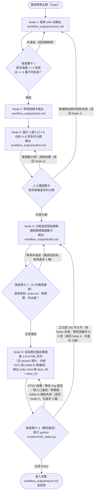

# 工作流：從 LLM Wiki 生成教學型 HTML 簡報系列（`topic-slides`）

本工作流嚴格遵循 [AGENTS.md](../../AGENTS.md) 與 [wiki/index.md](../../wiki/index.md) 之規範架構，將 `wiki/`（涵蓋俄國、德國、西班牙、中國、南斯拉夫五大區域及 `01_russian_civil_war.md`～`06_yugoslav_partisans.md` 六份唯讀原始來源）轉化為面向「**無歷史背景初學者**」的「**1 個系列策展總入口（`index.html`）＋ 6 份按主題／國家拆分的獨立簡報（`deck_00_framework.html`～`deck_05_yugoslavia.html`）**」離線互動式教學簡報系列。

相較單檔大簡報，此架構讓每個國家擁有**完整不跳躍的時間軸故事線**（每份獨立簡報嚴控 5～8 頁），同時透過同層相對路徑超連結（含 `#slide-N` 錨點）與「跨國連動卡片」彼此串接，兼顧單國深讀脈絡與跨歐亞比較視野。

## 全域鐵律與目錄約定

1. **唯讀與零外部知識**：嚴禁修改、覆寫或刪除 `raw/` 任何檔案；本工作流僅依據 `wiki/`（必要核對原文措辭時唯讀查閱 `raw/`）生產內容，嚴禁混入外部知識或模型自身記憶。
2. **嚴格溯源與語言規範**：正文採繁體中文，專有名詞首次出現時以括號附註原文（英文、德文、俄文、日文等）；所有年份、數據、人物與論點須保留 `[來源檔名, 段落標題]`；資料缺漏處須如實標註 `[資料不足／不確定：具體缺漏說明]`；史觀衝突處須並列呈現「觀點 A `[出處]`」與「觀點 B `[出處]`」。
3. **產物存放位置**：
   - 所有**中間產物與驗證報告**統一存放於 `workflow_output/`：
     - `workflow_output/sources.md`（Node 1：檢索清單與覆蓋率統計）
     - `workflow_output/cards.md`（Node 2：結構化證據卡）
     - `workflow_output/outline.md`（Node 3：系列大綱——總入口策展導覽 ＋ 6 份簡報各 5～8 頁完整時間軸大綱與跨簡報連動矩陣）
     - `workflow_output/drafts.md`（Node 4：總入口文案 ＋ 6 份簡報逐頁精簡講稿、跨國連動卡片與來源附註）
     - `workflow_output/report.md`（Node 4～5：忠實度審查與每輪腳本驗收修正歷程報告）
   - **本機圖片素材庫**：若簡報採用歷史影像 ``，須先下載並驗證儲存於專案根目錄 `assets/`（搭配 `assets/credits.md` 記錄授權）。
   - **最終展示系列（專案根目錄，1 總入口 ＋ 6 份跨連結簡報，供 GitHub Pages 與離線直接瀏覽）**：
     - `index.html`：**系列策展總入口**（導覽入口頁，不要求包含 `<section class="slide">`，須包含連向以下全部 6 份簡報的有效同層相對路徑連結）
     - `deck_00_framework.html`：**總論框架冊**（時代危機、左翼四派光譜、跨國流動網、成敗公式與史觀邊界，5～8 頁）
     - `deck_01_russia.html`：**俄國冊**（1917–1923 革命、四方內戰與一黨專政定型完整時間軸，5～8 頁）
     - `deck_02_germany.html`：**德國冊**（1918–1923 十一月革命、議會讓權、鎮壓極左與威瑪遺緒完整時間軸，5～8 頁）
     - `deck_03_china.html`：**中國冊**（1916–1949 北洋割據、黨軍移植、抗戰合作破裂與土改建政完整不跳躍時間軸，5～8 頁）
     - `deck_04_spain.html`：**西班牙冊**（1931–1939 第二共和極化、社會革命、內鬨敗局與禁運介入完整時間軸，5～8 頁）
     - `deck_05_yugoslavia.html`：**南斯拉夫冊**（1941–1948 軸心瓜分、跨族游擊建國、戰後清洗與蘇南分裂完整時間軸，5～8 頁）

---

## Graph 狀態流轉與局部退迴路線圖



---

## Node 1：主題檢索與覆蓋率關卡

- **輸入**：使用者給定的教學主題、[wiki/index.md](../../wiki/index.md)。
- **執行動作**：
  1. 先精讀 `wiki/index.md` 五大分類索引（`sources/`、`ideologies/`、`factions/`、`events/`、`syntheses/`），鎖定與教學主題直接及跨區連動之頁面。
  2. 善用 `wiki/syntheses/` 兩篇跨區比較頁與頁面內 `[[雙向連結]]`，識別隱含跨區關聯（例如白俄流亡部隊與 FT-17 坦克跨越俄、中、西三地；國際縱隊南斯拉夫志願者連結西班牙與南斯拉夫；列寧主義民主集中制與蘇聯軍援／契卡外溢連結俄、中、西、南），作為後續分冊間**跨國連動卡片與 `#slide-N` 超連結**的實證基礎。
  3. 統計入選頁面實際涵蓋的**地理區域**（俄國、德國、西班牙、中國、南斯拉夫）與實際溯源之**原始來源檔案**（`01_russian_civil_war.md`～`06_yugoslav_partisans.md`）。
  4. 寫入 `workflow_output/sources.md`。
- **`workflow_output/sources.md` 必備結構**：
  - 主題界定與教學焦點
  - 覆蓋率檢核表（區域清單及計數；原始來源清單及計數）
  - 入選 Wiki 頁面清單（欄位：`Wiki 相對路徑`、`涵蓋區域`、`關聯原始來源`、`一句話入選理由`）
  - 初步識別之 `raw/` 資料缺口提醒
- **檢查關卡 1（覆蓋率門檻）**：
  - 必須同時滿足：**(1) 至少涵蓋 3 個不同地理區域**；**(2) 至少引用 4 篇以上不同 `raw/` 原始來源檔案**。
  - **退回路線**：若任一條件不符，**立即退回 Node 1** 擴大檢索範圍（追蹤雙向連結或跨區事件頁）並更新 `workflow_output/sources.md`。若確因 `raw/` 收錄範圍限制而無法滿足，依誠實不知原則向使用者回報缺口並請求調整教學主題，絕不引入外部資料硬湊。

---

## Node 2：萃取證據卡

- **輸入**：通過檢查關卡 1 之 `workflow_output/sources.md` 及對應 `wiki/` 頁面內文。
- **執行動作**：
  1. 精讀入選的 `wiki/` 頁面正文，拆解為獨立可追溯的**原子化證據卡**（建議每張卡片聚焦單一核心事實、因果比較、數據組或史觀爭議）。
  2. 每張卡片必須嚴格雙重綁定：
     - 所屬 Wiki 頁面路徑：`[wiki/分類/檔名.md]`
     - 原始出處標籤：`[來源檔名, 段落標題]`（逐字核對 Wiki 頁面原有溯源標籤，不擅自簡化或臆測段落）
  3. 若該議題在 `wiki/` 存有史觀矛盾（如「防衛必要 vs. 一黨獨裁」、「SPD 抵禦布爾什維主義 vs. 背叛工人／妥協過頭」、「紅白恐怖規模與組織化爭議」、「皖南事變先開火互控」、「南斯拉夫戰後清洗與修正主義」等），**必須在同一張或成對卡片並列「觀點 A `[出處]`」與「觀點 B `[出處]`」**。
  4. 若遇 `[資料不足／不確定：...]` 標記，原樣摘錄至卡片缺漏備忘，供大綱與講稿誠實揭示邊界。
  5. 寫入 `workflow_output/cards.md`。
- **卡片標準格式範例**：
  ```markdown
  ### CARD-01：[卡片主題名稱]
  - **地區／流派／事件**：...
  - **Wiki 出處**：`[wiki/分類/檔名.md]`
  - **原始出處**：`[0X_來源檔名.md, 段落標題]`
  - **核心證據（含原文專有名詞、年份與數據）**：...
  - **史觀對照／缺漏備註**：...（無則填「單一記載，無史觀衝突」或詳列對照／`[資料不足／不確定：...]`）
  ```
- **輸出**：`workflow_output/cards.md`（嚴禁出現任何未標示出處或來自 `raw/` 以外的知識）。

---

## Node 3：系列大綱設計與人工確認關卡

- **輸入**：`workflow_output/cards.md`。
- **受眾原則（面向「沒有歷史背景的初學者」）**：
  - **單國完整敘事，拒絕時間跳躍**：透過「`index.html` 總入口 ＋ 6 份獨立簡報」拆分，讓初學者不必在單一長簡報裡於 1928 年中國與 1936 年西班牙之間來回跳切；每國分冊皆從該國起點順時序完整講到戰後結局與史觀爭議，跨國比較與共同框架則交由 `deck_00_framework.html` 與「跨國連動卡片（超連結跳轉）」承擔。
  - **禁止單頁過載**：每頁只設定 **1 個清楚的教學結論（Takeaway）** 與最多 2～4 個聚焦要點，將正文區（排除 `<footer>` 與 HTML 標籤）嚴控在 **260 個中文字**以內，保留雜誌版面的呼吸留白與圖像空間。
- **執行動作**：
  1. 規劃 **`index.html` 系列策展總入口**：說明全系列核心提問、推薦閱讀動線（先看 `deck_00` 建立框架，再任選五國單線深讀）以及 6 張分冊策展卡片（每張卡片明確對應 `deck_00_framework.html`～`deck_05_yugoslavia.html`）。
  2. 規劃 **6 份獨立簡報（`deck_00_framework.html`～`deck_05_yugoslavia.html`）**，確保**每份簡報的投影片總頁數嚴格落在 5～8 頁之間**（建議每冊 5～7 頁，第 1 頁皆為深色策展封面，最後一頁為該冊小結／史觀爭議與回流總入口或下一冊導引）。
  3. 設計 **跨簡報超連結與跨國連動卡片矩陣**：明確列出每個跨國連動點的「來源分冊與頁碼 `#slide-N` $\rightarrow$ 目標分冊與頁碼 `deck_XX_....html#slide-M`」以及所依據的 `CARD-XX`（確保目標頁碼 `M` 落在目標分冊總頁數內）。
  4. 每冊每頁大綱須寫明：
     - `所屬簡報與頁碼`（如 `deck_01_russia.html #slide-3`）
     - `標題`（一句完整白話論點）
     - `給初學者的白話問題／學習目標`
     - `排版視覺型態`（依內容交錯編排雜誌型版面，**嚴禁**連續兩頁或全部內頁重複左側粗色條圓角卡片）
     - `視覺素材規劃`（註明使用本機 `assets/` 歷史圖片、內嵌 `<svg>` 地圖／示意圖或純印刷排版）
     - `跨國連動卡片／跨簡報連結規劃`（若有，寫明連結文字與目標 `deck_XX_....html#slide-M` 或 `index.html`）
     - `綁定卡片清單`（明確列出 `CARD-XX`）
     - `該頁預計引用之原始來源`
  5. 輸出至 `workflow_output/outline.md`。
- **人工確認關卡（Human-in-the-Loop Pause）**：
  - 完成 `workflow_output/outline.md` 後，**必須暫停工作流，不得擅自進入 Node 4**。
  - 向使用者展示「1 總入口 ＋ 6 份分冊（各 5～8 頁）」系列大綱摘要、每國時間軸起訖與跨簡報連動矩陣，請使用者明確回覆確認。
  - **退回路線**：
    - 若使用者對分冊結構、頁面順序、教學深淺或連動設計不滿意：**退回 Node 3** 修改 `workflow_output/outline.md` 並再次送交確認。
    - 若使用者認為缺少關鍵地區、流派或史料面向：**退回 Node 1** 補充檢索，依序重跑 Node 2 更新 `cards.md` 與 Node 3 更新 `outline.md` 後再請確認。

---

## Node 4：分冊逐頁講稿與忠實度局部審查

- **輸入**：使用者已確認之 `workflow_output/outline.md` 與 `workflow_output/cards.md`。
- **撰稿規範**：
  1. 依 `outline.md` 撰寫 `index.html` 總入口策展導讀文案，以及 6 份簡報（`deck_00_framework.html`～`deck_05_yugoslavia.html`）逐頁講稿，輸出至 `workflow_output/drafts.md`（清楚標註分冊標題與每頁 `## [deck_XX] Slide YY (#slide-Y)：標題`）。
  2. **初學者友善與中文字數嚴控（<= 260 個中文字）**：
     - 使用簡潔短句與雜誌級精煉條列；排除頁底 `<footer>` 與 HTML 標籤後，單頁正文區（含標題、敘事、圖說、`<svg>` 內中文標籤與跨國連動卡片文案）**嚴格不超過 260 個中文字**（`[\u4e00-\u9fff]` 計數，建議撰稿控制在 **110～220 個中文字**以預留緩衝）。
     - 專有名詞首次出現時依 `AGENTS.md` 與 `cards.md` 沿用括號原文附註（不可自行替換或補譯）；因自動化腳本僅計數 CJK 中文字元，原文括號附註不會擠佔 260 中文字額度，但仍須維持初學者易讀性。
     - 若需呈現史料未載處，直接保留 `[資料不足／不確定：...]`；史觀衝突頁必須中立雙邊並列。
     - **跨國連動卡片文案**：凡放置於投影片正文內的跨簡報連結卡片（如連動其他國家的歷史線索），其事實陳述必須 100% 源自 `cards.md`，不可為製造跨國效果而腦補因果，且其中文字數計入該頁 260 中文字上限。
  3. **頁底強制標註來源出處**：每一頁講稿末尾必須附帶獨立一行來源標記，格式須包含 `來源：` 與至少一組 `[0X_來源檔名.md, 段落標題]`，並在草稿註記對應 `CARD-XX`。因自動化腳本排除 `<footer>` 計算正文字數，頁底來源應保持完整準確，無須刪減章節路徑。
- **檢查關卡 2（AI 忠實度審查與單頁局部 Loop）**：
  - 審查員視角逐冊逐頁比對 `workflow_output/drafts.md` 與 `workflow_output/cards.md`，核檢以下 5 項：
    1. 所有年份、百分比、金額、人數與人名／組織均精確吻合 `cards.md`，無張冠李戴。
    2. 無任何未經卡片記載的延伸推論、價值評斷或外部史實補腦（零超譯）。
    3. 頁底含完整 `來源：...` 與 `[來源檔名, 段落標題]`，且該頁正文區中文字數預估 <= 220 字（為 260 中文字硬性上限保留安全緩衝）。
    4. 遇史觀衝突時維持中立並列；遇缺漏時誠實標記不硬湊。
    5. 所有預定跨簡報連動連結皆具 `cards.md` 實證依據，且目標 `deck_XX_....html#slide-N` 頁碼存在於大綱規劃內。
  - **局部退回機制（關鍵規則）**：
    - 凡發現任何頁面違規，**僅退回並重新撰寫出錯的那一頁（或那幾頁）**，已通過審查的其餘分冊與頁面保持鎖定不動，嚴禁推翻全系列重寫。
    - **每頁局部 Loop 上限為 2 輪**。若單頁連改 2 輪仍因證據卡本身資訊不足而難以達標，必須改採 `[資料不足／不確定：...]` 誠實揭示並調整教學粒度。
    - 將各冊各頁第 1／2 輪忠實度審查紀錄暫存，待 Node 5 一併寫入 `workflow_output/report.md`。

---

## Node 5：渲染多冊互動式 HTML 系列與自動化腳本驗收

- **輸入**：通過檢查關卡 2 的 `workflow_output/drafts.md`。
- **HTML 系列架構與技術規格（1 總入口 ＋ 6 份跨連結簡報）**：
  1. **離線可執行、本機 `assets/` 圖片與內嵌 SVG 規則**：
     - 7 份 HTML 檔案（`index.html` 與 `deck_00_framework.html`～`deck_05_yugoslavia.html`）皆直接輸出於專案根目錄，各自將全部 CSS 與原生 JavaScript（Vanilla JS）內嵌於 HTML 中，不使用外部 CDN 樣式／字型／JS 套件，確保純本機雙擊開啟與 GitHub Pages 皆可離線運行。
     - **嚴禁未經下載的外部圖片網址**：所有檔案內皆不得出現指向 `http://`、`https://`、`//`、`data:` 或系統絕對路徑的 ``。
     - **本機 `assets/` 圖片搭配規則**：
       - 若採用歷史影像、海報或時代照片，必須先經來源與公開授權核實並實際下載非空檔案至專案根目錄 `assets/` 資料夾（例如 `assets/01_russia.jpg`），HTML 中僅能使用相對路徑 `src="assets/<檔名>"`。
       - 圖片須搭配精簡 `alt` 屬性與雜誌風圖說（`<figcaption>`）；圖說內容不得加入 `raw/`／`wiki/` 之外的額外史實推論，且其中文字計入正文區 260 中文字上限。
     - **內嵌 SVG 地圖與圖表搭配規則**：
       - 涉及歐亞跨區流動（如白俄流亡路線、蘇聯軍援網絡）、各地政權／游擊勢力分布或時間跨度對比，且無合適本機影像時，優先以純手寫**內嵌 `<svg>` 地圖或空間關係示意圖**呈現（100% 離線向量渲染、色調與米白紙色調和、標註精煉文字以免過度膨脹字數）。
  2. **跨簡報連結與 `#slide-N` 錨點路由規範**：
     - **同層相對路徑鐵律**：所有跨簡報與返回總入口連結（`href="deck_..."` 或 `href="index.html"`，含 `#slide-N` 錨點）皆必須使用同層相對路徑（如 `href="deck_03_china.html#slide-4"`、`href="index.html"`），嚴禁 `http://`、`https://`、`file://`、`/` 開頭絕對路徑、`..` 上層跳脫或 `?` 查詢字串。
     - **總入口（`index.html`）必備連結**：`index.html` 不要求包含 `<section class="slide">`，但必須提供清楚且有效的相對路徑 `<a href="...">` 連結至全部 6 份簡報（`deck_00_framework.html`、`deck_01_russia.html`、`deck_02_germany.html`、`deck_03_china.html`、`deck_04_spain.html`、`deck_05_yugoslavia.html`）。
     - **簡報頁碼錨點（`id="slide-N"`）與 JS Hash 同步**：
       - 6 份簡報內的每一張 `<section class="slide">` 皆**必須依序賦予 1 起算之 `id="slide-1"`、`id="slide-2"`、…、`id="slide-N"` 屬性**。
       - 簡報內嵌 Vanilla JS 須支援於載入頁面時讀取 `window.location.hash`（例如 `#slide-3`）以及監聽 `hashchange` 事件，自動切換至對應第 `N` 頁（並可於換頁時以 `history.replaceState` 同步更新網址列錨點，同時在頂部導覽列提供返回 `index.html` 與切換各國分冊的快捷連結）。
  3. **歷史雜誌策展風視覺規範**：
     - **紙感基底與克制印刷配色**：所有內頁畫布與總入口底色採用典藏米白紙色 **`#F7F4EB`**，搭配深墨炭色文字（如 `#1E1D1A`／`#23201B`）、暖石細分隔線（`1px` hairline）與低飽和歷史印刷強調色（朱砂紅、普魯士藍、檔案赭黃、銅綠），塑造《歷史期刊／博物館策展圖錄》閱讀質感。
     - **襯線標題字體階層**：頁面標題（`h1`、`h2`）與重點引文**必須採用襯線字體堆疊**（`"Noto Serif TC", "Source Han Serif TC", "Songti TC", "PMingLiU", "Georgia", serif`）；正文與出處欄搭配清晰無襯線字體（`system-ui, "Noto Sans TC", "PingFang TC", "Microsoft JhengHei", sans-serif`），年表與數據採等寬數字（`tabular-nums`）。
     - **總入口與分冊封面設計**：`index.html` 採策展特輯目錄頁設計（雜誌大封面刊頭 ＋ 閱讀路線導覽 ＋ 六冊典藏卡片）；每份獨立簡報第 1 頁（`<section class="slide slide--cover" id="slide-1">`）採**專屬深色全版面封面**，與第 2 頁起的 `#F7F4EB` 米白紙色內頁拉出明確對比。
     - **禁止重複單調卡片**：嚴禁將所有內頁千篇一律做成「`border-left` 粗色條＋圓角陰影方塊」網格；須依內容交錯編排雜誌型版面（文圖雙欄、全幅內嵌 SVG 地圖、報紙細線雙欄史觀對照、水平編年時間軸、跨國連動檔案索引條與大片留白）。
     - **互動控制**：支援鍵盤 `ArrowLeft`／`ArrowRight`（及 `PageUp`／`PageDown`）切換上一頁／下一頁，並提供畫面「上一頁」／「下一頁」按鈕點擊切換、頁碼進度條（`目前頁 / 總頁數`）與「返回總入口（`index.html`）」導覽鈕（導覽列 `<header>`／`<nav>` 與控制列皆置於 `<section class="slide">` 之外）。
  4. **嚴格遵守驗證結構標記**：
     - 所有 7 份檔案皆須包含完整 `<!DOCTYPE html>`、`<html lang="zh-Hant">`、`<head>`、`<body>` 及 `</html>`。
     - 6 份簡報（`deck_00_framework.html`～`deck_05_yugoslavia.html`）各自包含 **5～8 頁** `<section class="slide" id="slide-N">`（可加修飾 class 如 `slide--cover`、`slide--split`、`slide--map`）。
     - 每張 `<section class="slide">` 底部必須放入 **`<footer class="slide-source">`** 出處欄（例如 `<footer class="slide-source">來源：[01_russian_civil_war.md, 導言]</footer>`），且排除 `<footer>` 與 HTML 標籤後，**正文區純文字不超過 260 個中文字**（以 `[\u4e00-\u9fff]` 計數）。
     - `<section class="slide">` 內不得夾帶 `<script>` 或 `<style>` 區塊。
- **檢查關卡 3（自動化腳本硬性驗收，最多 3 輪）**：
  1. 執行驗證命令（一次驗收 `index.html` 總入口與全部 6 份獨立簡報）：
     ```bash
     python scripts/verify_slides.py
     ```
     確認同時通過以下 6 項硬性指標：
     - 根目錄 `index.html` 存在、HTML 結構完整（不要求包含 `<section class="slide">`），且包含連向 `deck_00_framework.html` 至 `deck_05_yugoslavia.html` 全部 6 份簡報的有效相對路徑連結。
     - `deck_00_framework.html` 至 `deck_05_yugoslavia.html` 全部 6 份簡報皆存在，且每份簡報的 `<section class="slide">` 總數介於 **5～8 頁**之間。
     - 每份簡報每一頁正文區（排除 `<footer>` 與 HTML 標籤）純文字不超過 **260 個中文字**。
     - 每份簡報每一頁皆包含 `<footer>` 標籤與明確資料來源標註（如 `來源：` 或 `[0...]` 來源檔名標記）。
     - 所有檔案皆結構完整（含 `<!DOCTYPE html>`、`<html>`、`</html>`），且所有 `` 皆使用相對路徑並指向本機 `assets/` 內真實存在的非空圖片檔。
     - 所有跨簡報連結（`href="deck_..."` 或 `href="index.html"`，含 `#slide-N` 錨點）皆使用相對路徑，且指向真實存在的目標檔案、有效頁碼（`1 <= N <= 目標總頁數`）與目標 HTML 內真實存在的 `id="slide-N"` 屬性。
  2. **退回與局部修正路線（上限 3 輪）**：
     - **通過（Exit Code 0）**：輸出完整 `workflow_output/report.md`。
     - **未通過（Exit Code != 0）**：依據腳本列印之逐冊逐頁診斷結果精準分流退回：
       - 若失敗原因為「正文區超過 260 個中文字」、「`<footer>` 漏標來源」或「單冊頁數不在 5～8 頁之間」-> **退回 Node 4** 僅針對未通過之分冊頁面精簡講稿／補全來源／調整分頁（已通過頁面鎖定不動，並維持 100% 忠實度），再重新渲染對應 HTML 後復驗。
       - 若失敗原因為「缺少 `<!DOCTYPE html>`／`</html>`」、「`<section class="slide">` 標籤格式錯誤」、「`` 路徑無效」、「`index.html` 缺漏 6 份簡報入口連結」或「跨簡報連結／`#slide-N` 錨點或 `id="slide-N"` 缺失／越界」-> **退回 Node 5** 修正對應 HTML 模板、補齊 `assets/` 圖片或修正跨簡報錨點後復驗。
     - **輪次上限**：檢查關卡 3 修正迴圈最多執行 **3 輪**；若第 3 輪仍未通過，停止自動修改，於 `workflow_output/report.md` 標記 `[未通過：需人工排除]` 並向使用者回報具體卡關分冊、頁面與數據。
- **`workflow_output/report.md` 強制紀錄內容**：
  1. 執行摘要（主題、1+6 系列各冊頁數與總頁數、覆蓋區域數與原始來源清單、跨簡報連動連結清單、最終驗收狀態）。
  2. Node 1～3 檢索與系列大綱確認摘記（含人工確認版本紀錄）。
  3. Node 4 分冊逐頁 AI 忠實度審查結果表（含哪些頁面觸發單頁局部退回、第 1／2 輪修改原因與最終定稿核可）。
  4. Node 5 每一輪執行 `python scripts/verify_slides.py` 的完整逐冊逐頁數據（`index.html` 入口連結檢查、6 份簡報各自頁數、各頁正文區中文字數、各頁 `<footer>` 來源檢查、`assets/` 圖片檢查與跨簡報 `#slide-N` 錨點檢查）、未通過頁之調整歷程與最終 `PASS` 驗證截錄。
