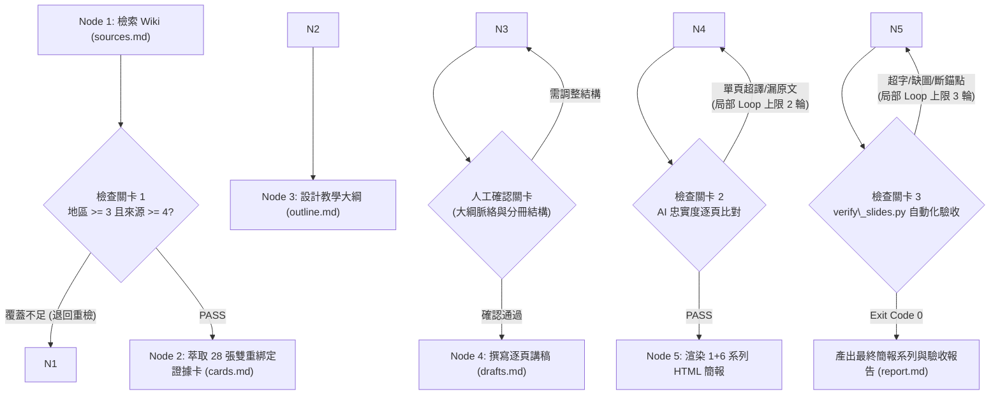

# 戰火下的路線分歧：1914–1945 歐亞社會主義流派與地方勢力的崛起比較

\---

## 一、LLM Wiki 主題與簡短介紹

### 1\. 知識庫主題

**1914–1945 世界大戰期間的社會主義流派與地方勢力興盛**

### 2\. 主題簡介

本知識庫探討兩次世界大戰與戰間期衝擊下，歐亞五大區域（**俄國及前帝國邊疆、德國、中國、西班牙、南斯拉夫**）的舊中央秩序如何瓦解，進而促使不同社會主義流派（布爾什維克、社會民主黨、無政府工團主義、抗戰統一戰線等）與地方武裝（工兵委員會、軍閥、農民自衛會社、敵後游擊隊）走向截然不同的路線，並分析最終決定其「覆滅整編」或「建國掌權」的關鍵條件。

### 3\. 建置方式與規模（先討論、後生成）

* **先需求訪談、後制定憲法 (`AGENTS.md`)**：正式建庫前先與 AI 進行需求釐清與規格確認，寫入專案規範 `AGENTS.md`，嚴格要求「**100% 溯源標註、嚴禁混入外部知識、史觀衝突雙邊並列、史料缺漏誠實標記 `\[資料不足／不確定：...]`**」。
* **原始資料與知識庫統計**：

  * **唯讀原始資料 (`raw/`)**：匯入 **6 篇**跨區域英文維基百科史料（俄國內戰、德國十一月革命、西班牙內戰、中國軍閥時代、第二次國共合作、南斯拉夫游擊隊）。
  * **結構化知識庫 (`wiki/`)**：共建置 **71 個 Markdown 頁面**（`sources/` 6 頁、`ideologies/` 17 頁、`factions/` 24 頁、`events/` 22 頁、`syntheses/` 2 頁），全庫包含 **1,242 處** `\[來源檔名, 段落標題]` 精確出處標註，經全庫體檢達 **0 斷鏈、0 孤島頁面**。

\---

## 二、專案目錄與教學 HTML 簡報架構

### 1\. 儲存庫目錄結構

```text
ww-socialism-wiki/
├── AGENTS.md                   # 專案憲法與嚴格溯源規範
├── .agents/workflows/
│   └── topic-slides.md         # 教學簡報 Graph + Loop 工作流定義
├── scripts/
│   └── verify\_slides.py        # 多簡報自動化驗收腳本（字數、出處、圖片、錨點檢查）
├── raw/                        # 6 篇唯讀原始英文史料（全程零修改）
├── wiki/                       # 71 頁結構化知識庫與編年日誌（log.md）
├── assets/                     # 5 張經 Wikimedia Commons API 驗證之歷史影像與授權紀錄
├── workflow\_output/            # 工作流中間產物（sources, cards, outline, drafts, report）
├── index.html                  # 系列策展總入口主頁
└── deck\_00\_framework.html \~ deck\_05\_yugoslavia.html  # 6 冊主題教學簡報（共 37 頁）
```

### 2\. 初學者導向的「1 策展總入口 ＋ 6 冊獨立簡報」（共 37 頁）

為避免沒有歷史背景的初學者在單一簡報中因頻繁切換國別而迷失脈絡，本專案採用「**單國完整時間軸 $\\times$ 跨冊錨點跳轉**」設計（支援鍵盤左右方向鍵、空白鍵、`PageUp`/`PageDown` 與畫面按鈕切換）：

|檔案名稱|單元名稱|頁數|核心教學內容與跨國連動|
|-|-|:-:|-|
|`index.html`|**策展總覽主頁**|導覽頁|五大戰區空間連動 SVG 地圖與 1914–1949 五國並置時間軸，30 秒建立全局座標。|
|`deck\_00\_framework.html`|**00｜總論與公式篇**|6 頁|權力真空起點、左翼四派光譜、歐亞六大跨國連動網與塞德曼（Michael Seidman）後方治安成敗公式。|
|`deck\_01\_russia.html`|**01｜俄國篇 (1917–1921)**|6 頁|從民選蘇維埃、解散立憲會議到紅白黑綠四方內戰，以及 1921 喀琅施塔得與一黨專政定型。|
|`deck\_02\_germany.html`|**02｜德國篇 (1918–1919)**|6 頁|基爾水兵起義、SPD 懼怕俄式內戰與舊軍資方妥協、工兵委員會 `344:98` 票交權與自由軍團鎮壓。|
|`deck\_03\_china.html`|**03｜中國篇 (1916–1949)**|7 頁|北洋軍閥割據、農民自衛會社、1923 列寧式黨軍移植、整批收編困局與抗戰敵後貧農土改翻盤。|
|`deck\_04\_spain.html`|**04｜西班牙篇 (1936–1939)**|6 頁|工人社會革命、「先革命或先贏戰」巴塞隆納五月內鬨、蘇聯 X 行動與 27 國禁運。|
|`deck\_05\_yugoslavia.html`|**05｜南斯拉夫篇 (1941–1948)**|6 頁|軸心瓜分、狄托跨民族「兄弟情誼」擴軍 80 萬、西班牙老兵骨幹與 1948 蘇南決裂。|

\---

## 三、Graph 與局部 Loop 工作流設計說明

### 1\. 工作流架構圖



### 2\. 重複執行（Loop）、檢查關卡與設計理由

* **哪些步驟會重複執行（局部 Loop）**：

  1. **Node 4 單頁忠實度迴圈（上限 2 輪）**：逐頁核對講稿與 `cards.md`，若發現專有名詞漏附原文、數據誤差或史觀未並列，**僅退回修改出錯的那一頁**。
  2. **Node 5 渲染與腳本硬性驗收迴圈（上限 3 輪）**：執行 Python 腳本 `scripts/verify\_slides.py` 檢查總入口連結、6 冊簡報頁數（5～8 頁）、單頁正文 CJK 中文字數（$\\le 260$ 字）、`<footer>` 來源標註、本機 `assets/` 圖片存在性及跨冊 `#slide-N` 錨點有效性，未通過時僅針對報錯頁面局部修正。
* **哪些地方需要檢查或重新生成**：

  * 設有 **3 道自動化檢查關卡**（檢索覆蓋率、AI 忠實度比對、Python 腳本硬性驗收）與 **1 道人工確認關卡**（Node 3 大綱審查與視覺體驗檢視）；任一關卡未過即局部退回重寫。
* **為什麼這樣設計**：

  * 若只用單一 Prompt 或整份重跑的大 Loop，修改單頁字數時容易連帶破壞前幾頁已校對好的史實與版面；透過 **Graph 拆解節點**並將中間產物落地為檔案（`sources.md` $\\rightarrow$ `cards.md` $\\rightarrow$ `outline.md` $\\rightarrow$ `drafts.md`），能把錯誤精準隔離在單一頁面快速修正，同時保留完整審計軌跡。

\---

## 四、實際執行結果與自動化驗收紀錄

1. **第一代單一簡報執行與退回紀錄**：

   * 初版產出單一 12 頁純文字簡報時，執行 `python scripts/verify\_slides.py` 第 1 輪回傳 **FAIL（Exit Code 1）**，攔截到 4 頁超過 380 字上限（Slide 04 為 420 字、Slide 09 為 441 字、Slide 10 為 456 字、Slide 11 為 386 字）；局部精簡後第 2 輪降至 310～380 字通過（Exit Code 0）。
   * 人工檢視發現「5 國擠在 12 頁造成跨國頻繁跳動」且「純文字卡片模板過度制式化」，遂退回重構為多冊圖文系列。
2. **第二代「1 總入口 ＋ 6 冊圖文策展系列」驗收紀錄**：

   * 透過 Wikimedia Commons API 下載並驗證 5 張歷史照片與地圖存於本機 `assets/`（授權記錄於 `assets/credits.md`），將簡報拆分為 `index.html` 總入口 ＋ `deck\_00`～`deck\_05` 共 6 冊（37 頁）。
   * 升級 `scripts/verify\_slides.py`（通過 12 項邊界單元測試）並執行全系列總驗收：全部 7 個 HTML 檔案、37 頁投影片（每頁正文 109～226 中文字，皆 $\\le 260$ 字）、5 張本機歷史圖片與 14 組跨冊 `#slide-N` 錨點連結皆回傳 **PASS（Exit Code 0）**。

\---

## 五、執行反思與工作流演進

* **哪一個節點最常出錯**：

  * \*\*跨區綜合與多國並置視覺節點（`wiki/syntheses/` 與首頁 SVG 導覽圖）\*\*最容易出錯——早期在統整多國數據時曾出現戰俘人數誤差，而在繪製歐亞五大戰區空間連動 SVG 時，也因文字長度預估不足產生外框切字與連線壓過節點標題的視覺重疊。
* **發現問題後，把檢查往前移到了哪一個步驟**：

  1. **在生成簡報前增設「全庫引用 Lint 體檢」**：在啟動簡報工作流前先掃描全庫 71 頁，提前修正 `syntheses/` 中的西班牙國民軍戰俘人數（更正為「約 10.7 萬名戰俘中回收約 5.9 萬人」）並移除原始資料未載的「共產國際」字眼，阻斷錯誤數據流入簡報。
  2. **將字數口徑與國別拆分規則前移至架構與腳本設計階段**：在架構層改為「1 總入口 ＋ 6 冊獨立主題簡報」，並將 `verify\_slides.py` 調整為「排除 `<footer>` 出處與英文括號原文，僅計算正文 CJK 中文字 $\\le 260$ 字」，從源頭避免 AI 為閃避超字而寫出電報式縮寫。
* **對 Workflow / Graph 的修改與體會**：

  * 我修改了 `.agents/workflows/topic-slides.md` 與 `scripts/verify\_slides.py`：新增「本機 `assets/` 圖片存在性驗證」、「跨冊 `#slide-N` 錨點目標頁碼驗證」與「歷史雜誌策展風排版規範」，驗證了「自動化腳本能守住溯源與格式底線，而人工確認關卡則能把關初學者的閱讀連貫性與視覺品質」。

